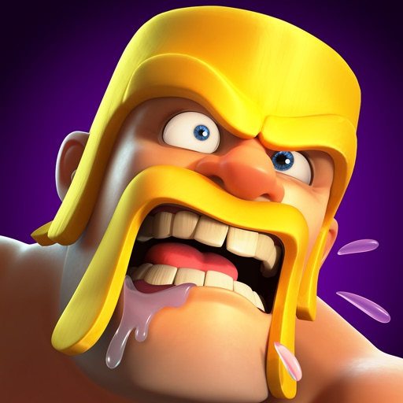
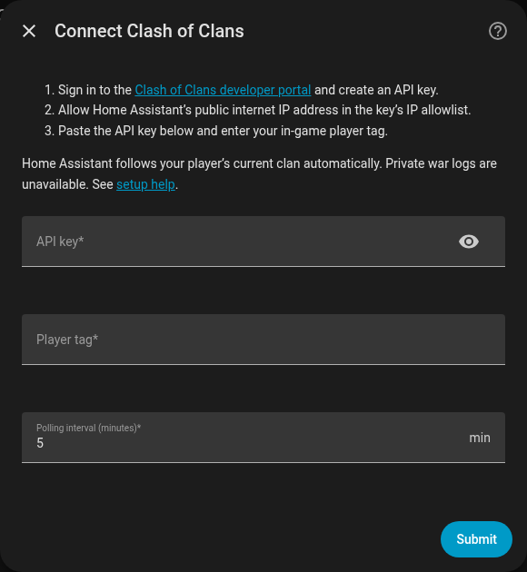

# Clash of Clans for Home Assistant

Player, clan and public clan-war sensors using Supercell's API. Enter a player tag once; the integration follows that player's current clan automatically.

## Installation

Requires **Home Assistant Core 2026.11.0 or newer**.

1. Copy `custom_components/clash_of_clans` into your Home Assistant `config/custom_components` directory.
2. Restart Home Assistant.
3. Open **Settings → Devices & services → Add integration → Clash of Clans**.

## Create an API key

1. Sign in at the [Clash of Clans developer portal](https://developer.clashofclans.com/).
2. Open **My Account → Create New Key** and enter a name and description.
3. Under **Allowed IP addresses**, enter the public IP address of the network running Home Assistant.
4. Create the key, then paste its **Token** into the integration's **API key** field and enter your in-game **Player tag**.

Polling defaults to five minutes and can be changed from 1–60 minutes through **Configure**. Add another entry to monitor another player.

## Sensors

| Group | Sensors |
| --- | --- |
| Player | Trophies, best trophies, Town Hall level, XP level, war stars, donations, donations received, attack and defense wins, Builder Base trophies, Clan Capital contributions, league |
| Current clan | Members, level, clan points |
| Current war | State, clan stars, opponent stars, attacks used, end time |

## Limitations

- The API does not provide resource balances, builder availability, training queues or upgrade timers.
- War details require a public war log. Private logs leave war sensors unavailable; player and clan sensors still work. Clan War League rounds and raid-weekend details are not included.

Clash of Clans artwork belongs to Supercell; see [NOTICE.md](NOTICE.md). This material is unofficial and is not endorsed by Supercell. See Supercell's [Fan Content Policy](https://supercell.com/en/fan-content-policy/).
